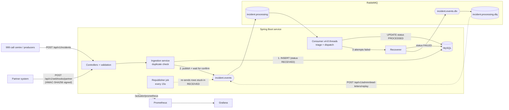

# Incident Event Integration Service

[](https://github.com/ethanho03987/incident-event-integration-service/actions/workflows/ci.yml)

A Java 21 / Spring Boot service that takes in simulated emergency incident events (fires, medical calls,
road collisions…) from **REST** and **signed webhook** endpoints, stores them in **MySQL**, and processes
them asynchronously through **RabbitMQ**. The goal is that no event is ever lost: it has retries,
a dead-letter queue, duplicate-event handling, and monitoring with Actuator, Prometheus and Grafana.

| | |
|---|---|
| **Stack** | Java 21, Spring Boot 3.5, Spring Data JPA (Hibernate), Flyway, MySQL 8, Spring AMQP / RabbitMQ, Micrometer, Prometheus, Grafana |
| **Testing** | JUnit 5, Mockito, AssertJ, MockMvc, Testcontainers, Awaitility, JaCoCo, k6 |
| **Delivery** | Docker (multi-stage), Docker Compose, GitHub Actions |

## Results (measured in CI on every push)

| Check | Result |
|---|---|
| Unit tests | 73 passing |
| Integration tests (real MySQL + RabbitMQ via Testcontainers) | 11 passing |
| Line coverage (JaCoCo, unit + integration) | **98.4%**. The build fails if it drops below 70% |
| Load test (k6, constant 50 events/sec for 2 min) | 5,999 events accepted, **5,999 processed, 0 lost**, 0 dead-lettered |
| HTTP latency under load | p95 = 11.9 ms, 0% errors |
| Duplicate detection under load | 607 of 607 duplicate submissions correctly rejected |

## Architecture



### Event lifecycle

```
RECEIVED ──(RabbitMQ confirms)──▶ QUEUED ──(consumer succeeds)──▶ PROCESSED
    │                                 │
    │ never confirmed                 └──(3 attempts fail)──▶ FAILED ──(replay)──▶ QUEUED
    └──▶ republisher sends it again
```

## How it avoids losing or duplicating events

| Problem | What the service does | Where |
|---|---|---|
| Producer sends the same event twice | `event_id` has a **UNIQUE constraint**. A repeat returns `200 DUPLICATE` instead of `202`, and nothing new is queued. Two identical requests at the same instant are also handled: the losing INSERT is caught and treated as a duplicate. | `IncidentIngestionService` |
| RabbitMQ is down or the app crashes right after saving | The event is saved **before** publishing. **Publisher confirms** mean a row only becomes `QUEUED` once the broker has acknowledged it. Rows left in `RECEIVED` are re-sent by a scheduled **republisher** (a lightweight transactional-outbox pattern). | `IncidentEventPublisher`, `StuckEventRepublisher` |
| Broker restarts | Exchanges and queues are **durable** and messages are **persistent**. | `RabbitConfig` |
| Same message delivered twice (RabbitMQ is at-least-once) | The consumer is **idempotent**: an event already `PROCESSED` is skipped. A `@Version` column (optimistic locking) covers two copies being processed at the same moment. | `IncidentProcessor` |
| Downstream dispatch system temporarily down | **Retries with exponential back-off**: 3 attempts, 500 ms then 1 s. | `application.yml` → `spring.rabbitmq.listener.simple.retry` |
| It keeps failing | The message goes to the **dead-letter queue** with the exception in its headers, and the event is marked `FAILED` with the reason. Once the problem is fixed, `POST /api/v1/admin/dead-letters/replay` moves messages back. | `FailedIncidentRecoverer`, `DeadLetterReplayService` |
| Forged or replayed webhooks | **HMAC-SHA256** signature over `timestamp + "." + body`, compared in constant time. Requests older than 5 minutes are rejected. | `WebhookSignatureVerifier` |

## Running it

You need Docker. Java 21 and Maven are only needed if you want to run it outside Docker.

```bash
docker compose up -d --build --wait
```

| What | URL |
|---|---|
| Swagger UI (try the API in the browser) | http://localhost:8080/swagger-ui.html |
| Health | http://localhost:8080/actuator/health |
| RabbitMQ management (guest / guest) | http://localhost:15672 |
| Prometheus | http://localhost:9090 |
| Grafana dashboard | http://localhost:3000 |

### Try it

```bash
# Submit an incident -> 202 Accepted
curl -i -X POST localhost:8080/api/v1/incidents -H 'Content-Type: application/json' -d '{
  "eventId": "evt-001", "source": "999-call-centre", "type": "FIRE", "severity": "HIGH",
  "latitude": 53.4808, "longitude": -2.2426, "description": "Kitchen fire, person trapped",
  "occurredAt": "2026-11-25T14:30:00Z" }'

# Send it again -> 200 {"status":"DUPLICATE"}
# Check its status, triage result and assigned service
curl localhost:8080/api/v1/incidents/evt-001

# Signed partner webhook (run twice with the same id to see duplicate handling)
./scripts/send-webhook.sh ptn-001

# Counts by status
curl localhost:8080/api/v1/incidents/stats
```

### See retries and the DLQ in action

```bash
DISPATCH_FAILURE_RATE=0.5 docker compose up -d app     # half of all dispatch calls now fail
k6 run -e DURATION=1m loadtest/incident-load-test.js  # watch retries + DLQ depth in Grafana
DISPATCH_FAILURE_RATE=0 docker compose up -d app       # "fix" the downstream system
curl -X POST localhost:8080/api/v1/admin/dead-letters/replay
```

### Load test

```bash
docker compose down -v && docker compose up -d --build --wait   # fresh database
k6 run --summary-export loadtest/results/summary.json loadtest/incident-load-test.js
./loadtest/verify-no-loss.sh      # compares k6's accepted count with what reached PROCESSED
```

## Tests

```bash
mvn verify                      # unit + integration tests + coverage check (needs Docker for Testcontainers)
mvn test                        # unit tests only, no Docker needed
open target/site/jacoco/index.html
```

* **Unit tests** (`*Test.java`) use Mockito for dependencies and run in milliseconds: triage rules,
  signature verification, payload mapping, ingestion/duplicate logic, publisher, republisher, recoverer.
* **Web slice tests** (`@WebMvcTest`) cover status codes, validation errors and JSON shape.
* **Integration tests** (`IncidentFlowIT`) start the whole app against real MySQL and RabbitMQ containers and
  check the full flow: REST → processed, webhook → processed, duplicates, 10 concurrent identical
  requests, redelivered messages, retry → DLQ → replay, republishing of stuck rows, and the Prometheus metrics.

## API

| Method | Path | Purpose |
|---|---|---|
| `POST` | `/api/v1/incidents` | Submit an event (202 new / 200 duplicate / 400 invalid) |
| `GET` | `/api/v1/incidents/{eventId}` | One event with status and triage result |
| `GET` | `/api/v1/incidents?status=&page=&size=` | Paged list, newest first |
| `GET` | `/api/v1/incidents/stats` | Count per status |
| `POST` | `/api/v1/webhooks/partner` | Signed partner webhook (401 if signature invalid) |
| `POST` | `/api/v1/admin/dead-letters/replay?max=` | Replay DLQ messages |

Errors use the RFC 7807 Problem Details JSON format.

## Monitoring

Custom Micrometer metrics, exposed at `/actuator/prometheus` and shown on the provisioned Grafana dashboard:

* `incidents_received_total{channel}`, `incidents_processed_total{type,severity}`, `incidents_duplicates_total`
* `incidents_dead_lettered_total`, `incidents_publish_failures_total`, `incidents_republished_total`, `incidents_duplicate_deliveries_total`
* `incidents_processing_duration_seconds` and `incidents_end_to_end_latency_seconds` (histograms → p50/p95/p99)
* `incidents_queue_depth{queue="processing|dead_letter"}`
* Built-in: HTTP request rates and latencies, JVM memory, DB connection pool, RabbitMQ broker metrics

## Project structure

```
src/main/java/com/ethanho/incidents
├── api/          REST controllers, request/response records, error handling
├── webhook/      Partner webhook: signature check, payload mapping
├── ingestion/    Shared ingestion path (duplicate check → save → publish)
├── messaging/    RabbitMQ topology, publisher, consumer, republisher, DLQ recoverer & replay
├── processing/   Triage rules, dispatch gateway, processor
├── domain/       JPA entity, enums, repository
├── metrics/      Custom Micrometer metrics
└── config/       Typed configuration, Clock bean
src/main/resources/db/migration   Flyway SQL migrations
loadtest/                         k6 script + no-loss verification
monitoring/                       Prometheus config, Grafana datasource + dashboard
```

## Design decisions and trade-offs

* **MySQL is the source of truth; messages only carry IDs.** Re-sending a message is always safe, and the
  data can't drift between the message and the database.
* **Republisher rather than a full outbox table.** The `incident_events` row itself acts as the outbox entry.
  It's simpler, but an event can be published twice (once normally, once by the republisher). That's why
  the consumer has to be idempotent.
* **At-least-once, not exactly-once.** Exactly-once delivery across a database and a broker isn't practical.
  The service accepts at-least-once delivery and makes processing idempotent instead. The downstream dispatch call should
  also use `eventId` as an idempotency key.
* **Stateless retries inside the consumer.** Simple, with short back-off. For long outages you'd use a
  delayed-retry queue (TTL + DLX) so consumer threads aren't held up.

## What I'd add next

* Authentication on the API (OAuth2 / API keys) and the admin endpoint
* A per-partner secret store and key rotation for webhooks
* Distributed tracing (Micrometer Tracing + OpenTelemetry) across HTTP → RabbitMQ → consumer
* Kubernetes manifests and horizontal scaling of consumers based on queue depth
